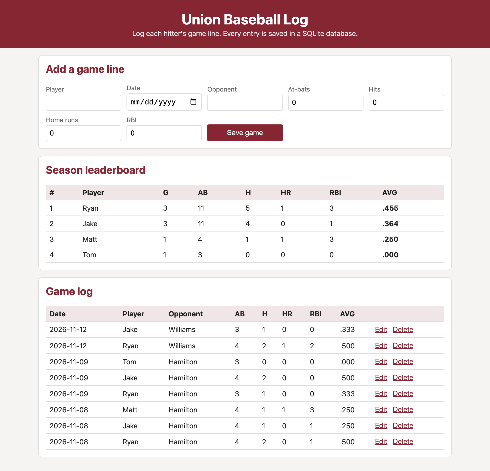

# Union Baseball Log

A hitting stat log for the Union College baseball team. Log each player's game line (at-bats, hits, home runs, RBI), fix or delete a line later, and see the whole team ranked by season batting average.

CSC-240 Web Programming · Final Project · **Track 2: Backend & Database** · Ryan Kolodziejczyk



## Built with

| Tool | What it does here |
| --- | --- |
| **Node.js 22** | Runs the server. Its built-in `node:sqlite` module talks to the database, so there is no separate database driver to install. |
| **Express 4** | Routes each URL to a handler, reads submitted forms into `req.body`, and serves the CSS file. |
| **SQLite** | Stores every game line in one file, `baseball.db`, which is created automatically on the first run. |

## Run it locally

### 1. Install Node.js 22.13 or newer

Check your version:

```bash
node -v
```

It must print `v22.13.0` or higher. Older versions (Node 20, for example) don't have `node:sqlite` and stop with `No such built-in module: node:sqlite`.

If you use [nvm](https://github.com/nvm-sh/nvm), run these inside the project folder. They read the `.nvmrc` file:

```bash
nvm install
nvm use
```

Without nvm, download the LTS version from [nodejs.org](https://nodejs.org).

### 2. Get the code

```bash
git clone https://github.com/KolodziejczykR/union-baseball-log.git
cd union-baseball-log
```

### 3. Install the dependencies

```bash
npm install
```

This installs Express, the only dependency.

### 4. Start the server

```bash
npm start
```

The terminal shows:

```
Union Baseball Log running at http://localhost:3000
```

Open **http://localhost:3000** in your browser. Stop the server with `Ctrl + C`.

Node also prints `ExperimentalWarning: SQLite is an experimental feature`. That warning is normal and harmless.

**Port 3000 already in use?** Pick another port:

```bash
PORT=4000 npm start
```

## How to use it

- **Add a game line.** Fill in the form at the top and click **Save game**. The line appears in the game log, and the leaderboard updates.
- **Edit a line.** Click **Edit** on any row in the game log, change the numbers, and click **Save changes**.
- **Delete a line.** Click **Delete** on a row and confirm.
- **Season leaderboard.** Adds up every player's lines and ranks the team by batting average (hits ÷ at-bats). A player with 0 at-bats shows `---` and sorts last.

The server checks every line before saving it. Player, date, and opponent are required. Stats must be whole numbers, 0 or more. Hits can't be more than at-bats, and home runs can't be more than hits. A line that breaks a rule is not saved: the form comes back with the error message and everything you typed, so you only fix the bad box.

## Project structure

```
union-baseball-log/
├── server.js            Starts Express: form parsing, static files, routes
├── db.js                Opens baseball.db and creates the games table
├── routes/
│   └── games.js         Every URL: list, add, edit, update, delete
├── views/
│   └── page.js          Builds each HTML page with template literals
├── public/
│   └── css/style.css    All styling (Union garnet)
├── docs/
│   └── screenshot.png   The picture at the top of this README
├── package.json         Start script, Node version, dependencies
└── .nvmrc               Node version for nvm
```

`baseball.db` (the data) and `node_modules/` are created on your machine and are not in the repository.

## Routes

| Method | URL | What it does |
| --- | --- | --- |
| GET | `/` | Home page: add form, season leaderboard, game log |
| POST | `/games` | Saves a new game line (Create) |
| GET | `/games/:id/edit` | Edit form, filled in with that line's numbers |
| POST | `/games/:id` | Saves the edited line (Update) |
| POST | `/games/:id/delete` | Deletes the line (Delete) |

HTML forms can only send GET or POST, so update and delete are POST requests to their own URLs. After every successful save the server redirects back to `/`, so refreshing the page never submits the same game twice.

## Database

One table, `games`. Each row is one player's hitting line from one game.

| Column | Type | Notes |
| --- | --- | --- |
| `id` | INTEGER | Primary key, assigned automatically |
| `player` | TEXT | Required |
| `game_date` | TEXT | Required, `YYYY-MM-DD` |
| `opponent` | TEXT | Required |
| `at_bats` | INTEGER | Required |
| `hits` | INTEGER | Required |
| `home_runs` | INTEGER | Defaults to 0 |
| `rbi` | INTEGER | Defaults to 0 |

Every query that includes something the user typed uses `?` placeholders, so typed text is always stored as data and never run as SQL.

**Start over with an empty log:** stop the server, delete `baseball.db`, and start it again. A new empty database is created.

## AI use

I built this project with help from Claude (Claude Code by Anthropic), as the course's AI policy allows. Each source file starts with a short disclosure header. The full AI disclosure and the chat log are in Chapter 4 of my final report.
